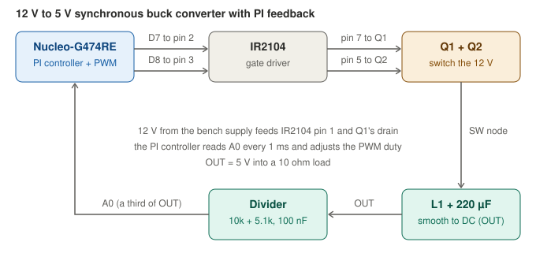
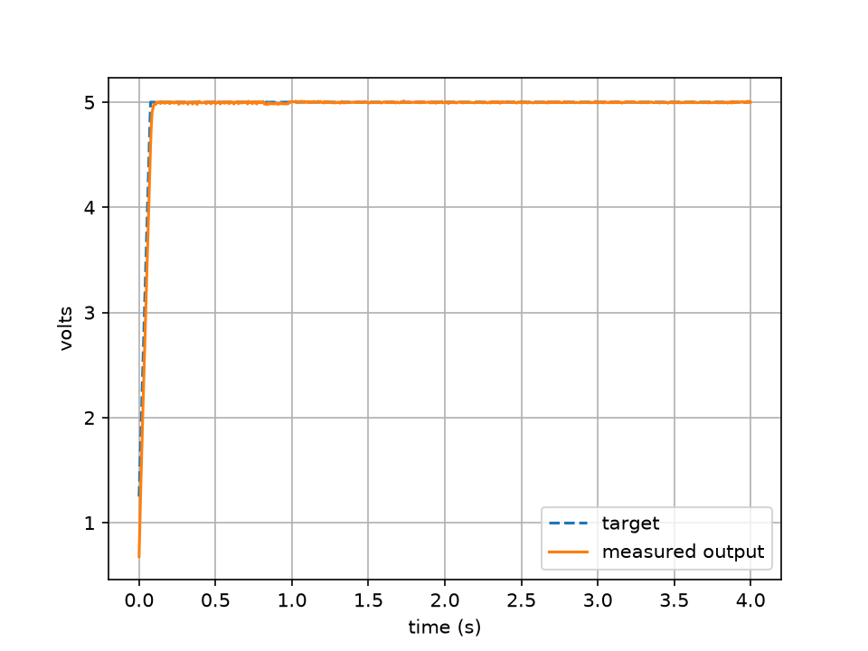
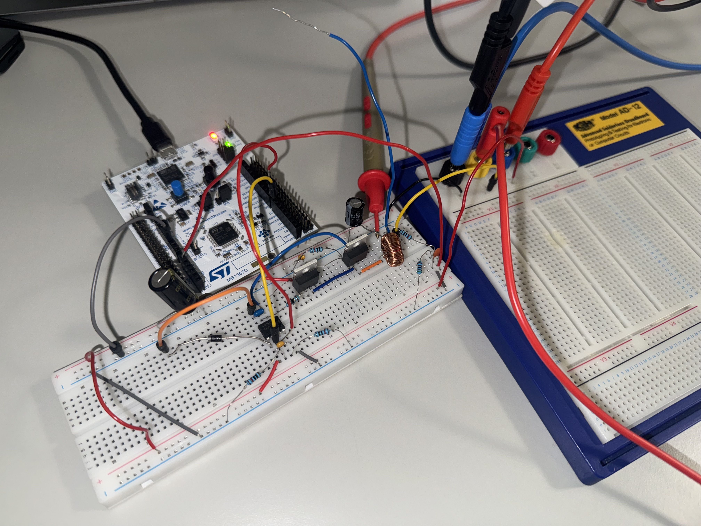

# Closed-loop synchronous buck converter

A 12 V to 5 V DC-DC converter built on a breadboard and controlled by an STM32
Nucleo-G474RE. The microcontroller generates a 50 kHz PWM signal, measures the
output through its ADC, and uses a PI controller to hold 5 V. I designed it with
hand calculations, simulated it in LTspice, built it in stages with a test after
each one, and measured it on bench equipment.



## Results

| | |
|---|---|
| Regulation, body-diode version (12 V in, 10.11 Ω load) | 4.9878 V measured, 0.24 % below the 5.000 V target |
| Regulation, synchronous version (11.99 V in) | 4.9740 V measured, 0.5 % below the target |
| Line regulation, body-diode version (11 to 14 V in) | output varies by 7.4 mV while the duty cycle falls from 51.3 % to 40.7 % |
| Start-up, body-diode version | reaches 5 V in about 0.1 s with no visible overshoot |
| Efficiency, body-diode version | about 92 % |
| Efficiency, synchronous version | about 96 % |

Both efficiency figures were calculated from the bench supply's current display,
which wanders by several mA, so each is accurate to a few points. The duty cycle
falling from 47.2 % to 43.9 % when the low-side MOSFET started switching is the
cleaner evidence of the improvement.



Output voltage following the 100 ms soft-start ramp on the body-diode version, captured over serial.



## How it works

1. The Nucleo's timer produces a 50 kHz PWM signal with a duty cycle set by the
   controller.
2. An IR2104 gate driver turns that 3.3 V signal into gate drive for two IRLZ44N
   MOSFETs. The high-side MOSFET needs a gate voltage above the supply, which the
   driver makes with a bootstrap diode and capacitor.
3. The MOSFETs chop the 12 V supply into pulses, and a 220 µH inductor and 220 µF
   capacitor smooth them into DC. The output is roughly the input times the duty
   cycle.
4. A 10 kΩ / 5.1 kΩ divider scales the output to about a third so the ADC can
   read it. Every millisecond the firmware compares the reading with 5 V and
   adjusts the duty cycle with a PI controller. The target ramps up over 100 ms
   at start-up, the duty cycle is limited to 55 %, and the output shuts off above
   5.8 V.
5. In the final version the driver also switches the low-side MOSFET on while the
   high side is off (synchronous rectification) instead of letting its body diode
   conduct. Because that makes "no PWM" mean "low side fully on", the firmware
   also controls the driver's shutdown pin so that a reset or trip switches both
   MOSFETs off.

## How I built it

| Stage | What I did | Where |
|---|---|---|
| Design | Hand calculations: duty cycle 41.7 %, ripple current 0.27 A, continuous conduction, critical inductance about 58 µH against the 220 µH used | [docs/design-calculations.md](docs/design-calculations.md) |
| Simulation | LTspice model of the power stage. It predicted 4.45 V open loop against 4.325 V measured | [simulation](simulation) |
| Firmware | Blink, then a 50 kHz PWM from a timer, then the ADC and PI controller | [firmware](firmware) |
| Breadboard | The gate driver tested alone, then the power stage. Open loop it gave 4.325 V at 84 % efficiency | [hardware](hardware) |
| Closed loop | Voltage divider, ADC, PI controller, soft start and protection | [hardware](hardware), [firmware](firmware) |
| Synchronous | Low-side MOSFET driven from the IR2104, with firmware-controlled shutdown | [hardware](hardware) |

A day-by-day record, including the mistakes, is in
[docs/engineering-log.md](docs/engineering-log.md).

## Parts and equipment

| Part | Value |
|---|---|
| Microcontroller | STM32 Nucleo-G474RE |
| Gate driver | IR2104 (PDIP-8) |
| MOSFETs | 2 x IRLZ44N |
| Inductor | 220 µH, 1 A, 160 mΩ toroid |
| Capacitors | 220 µF 25 V output, 470 µF 35 V input, 1 µF bootstrap, 100 nF ceramics |
| Bootstrap diode | UF4007 |
| Load | 10 Ω 10 W power resistor (measured 10.11 Ω) |

Measured with a Keithley 2231A-30-3 bench supply, a Tektronix TBS2000B
oscilloscope and a Keithley 2110 multimeter.

## Problems I ran into

- A diode-mode reading of 0.01 V on the switching node looked like a short. It
  was the load resistor, reached through a second breadboard.
- In the synchronous upgrade, a continuity check read 20 Ω from Q2's gate to
  ground instead of 10 kΩ. The gate resistor was one pin out, in the switching
  node's row, which would have connected Q2's gate to the switching node and
  shorted the supply through both MOSFETs. I found it before applying power.
- A flash that silently failed: the serial window stayed blank and the LED still
  blinked at the old rate.
- The oscilloscope's automatic measurements jumped between frames because of
  ringing on the switching edges. I froze a good frame and read levels from
  cursors.
- The first synchronous run gave no output because I had not plugged in the PWM
  wire.
- STM32CubeIDE 2.x no longer includes CubeMX, so projects are generated in
  standalone CubeMX and imported from the `STM32CubeIDE` subfolder.

## Limitations

- Efficiency comes from the supply's current display, not from a multimeter in
  series, and the body-diode and synchronous versions were measured on the same
  day but not back to back.
- Output ripple was not measured. The simulation predicts about 16 mV.
- The 11 V line-regulation reading (0.293 A) looks wrong, and I did not find out
  why.
- The synchronous version regulates 0.5 % below target on the multimeter, which an
  integral controller should not allow. I have not found the cause.
- There is no PCB, so the switching edges are noisy.

## What I would do next

- Lay the circuit out as a PCB in KiCad and compare the switching waveforms.
- Re-measure efficiency with the input current read on a multimeter, back to back.
- Measure ripple with a short ground connection, and the response to a load step.
- Find the cause of the small steady-state offset.

## Repository layout

```
docs/          design calculations, engineering log, block diagram
firmware/      STM32CubeMX / CubeIDE project and notes
hardware/      wiring tables, photos and measurements for each stage
simulation/    LTspice files and screenshots
test-data/     serial logs, plots and the Python scripts that made them
```

## Reproducing it

1. Build the circuit from the wiring tables in [hardware/README.md](hardware/README.md).
2. Open `firmware/buck-firmware/buck-firmware.ioc` in STM32CubeMX and generate code.
3. Open `firmware/buck-firmware/STM32CubeIDE` in STM32CubeIDE 2.x, build and flash.
4. Run `python3 test-data/capture.py <serial port> 4` to log the output.
   It needs pyserial and matplotlib.

## About this project

The PI controller and some of the design guidance were developed with help from
Claude (Anthropic). I built, flashed, measured and debugged everything on the
bench, and the results here are my own measurements.