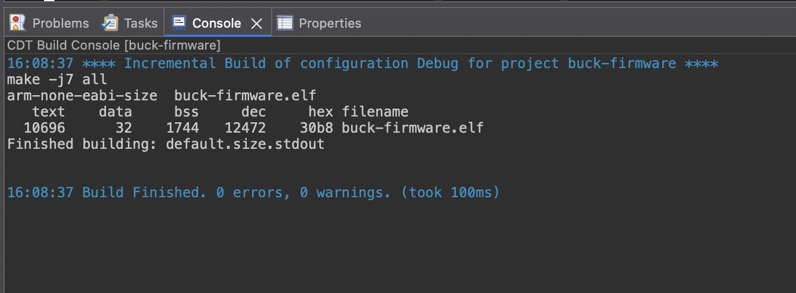
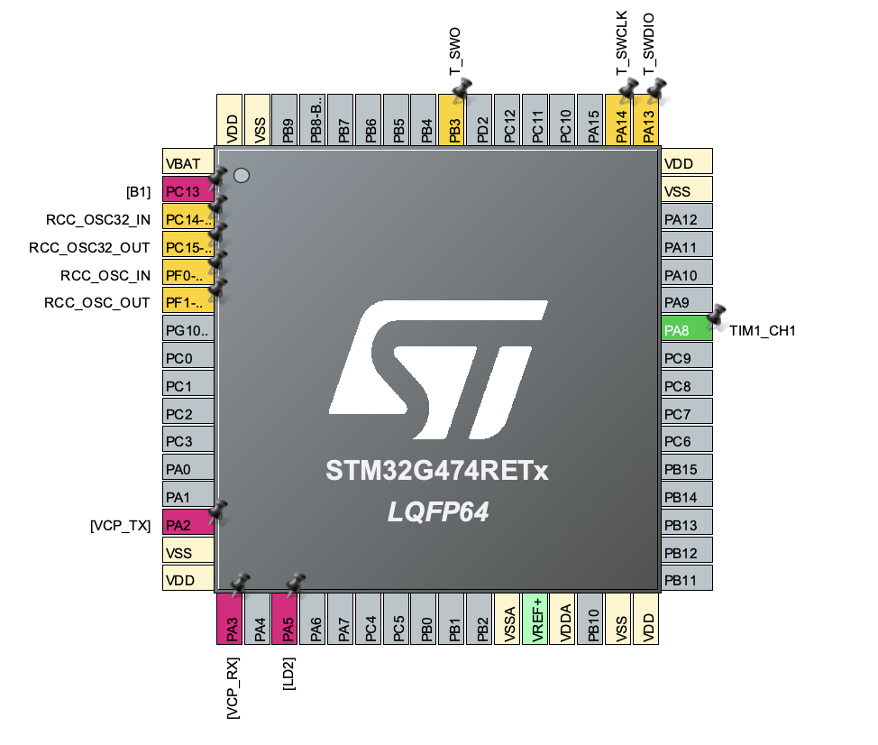
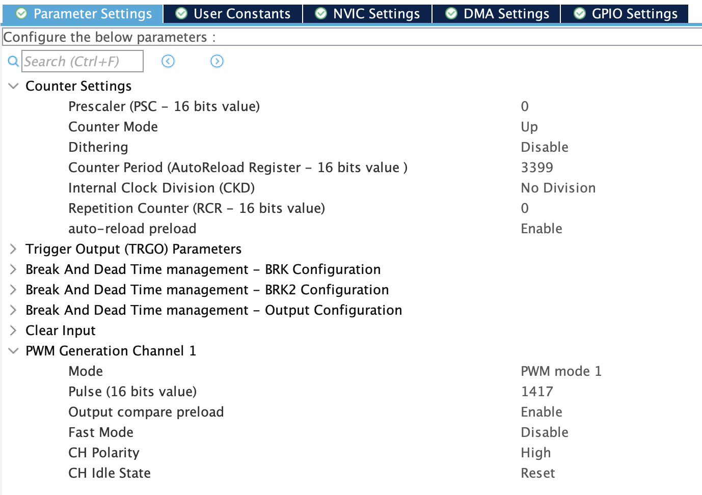
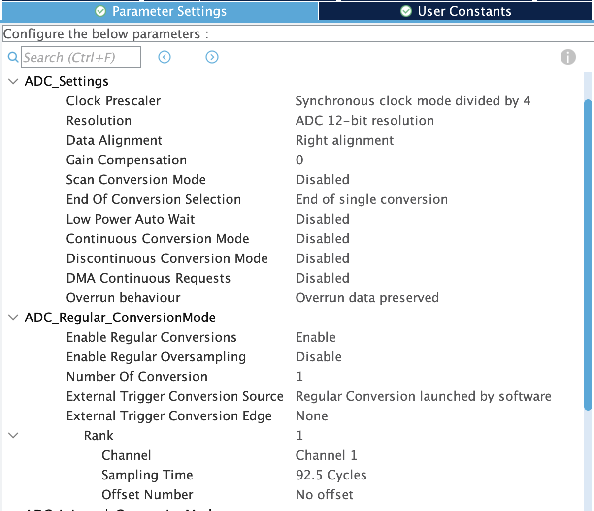
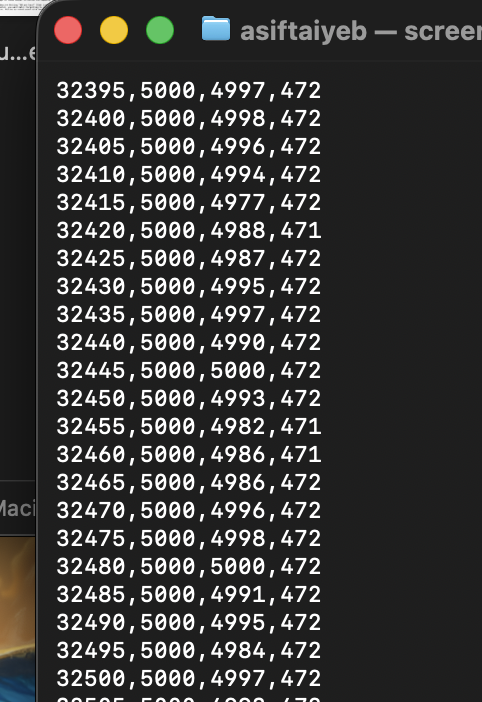
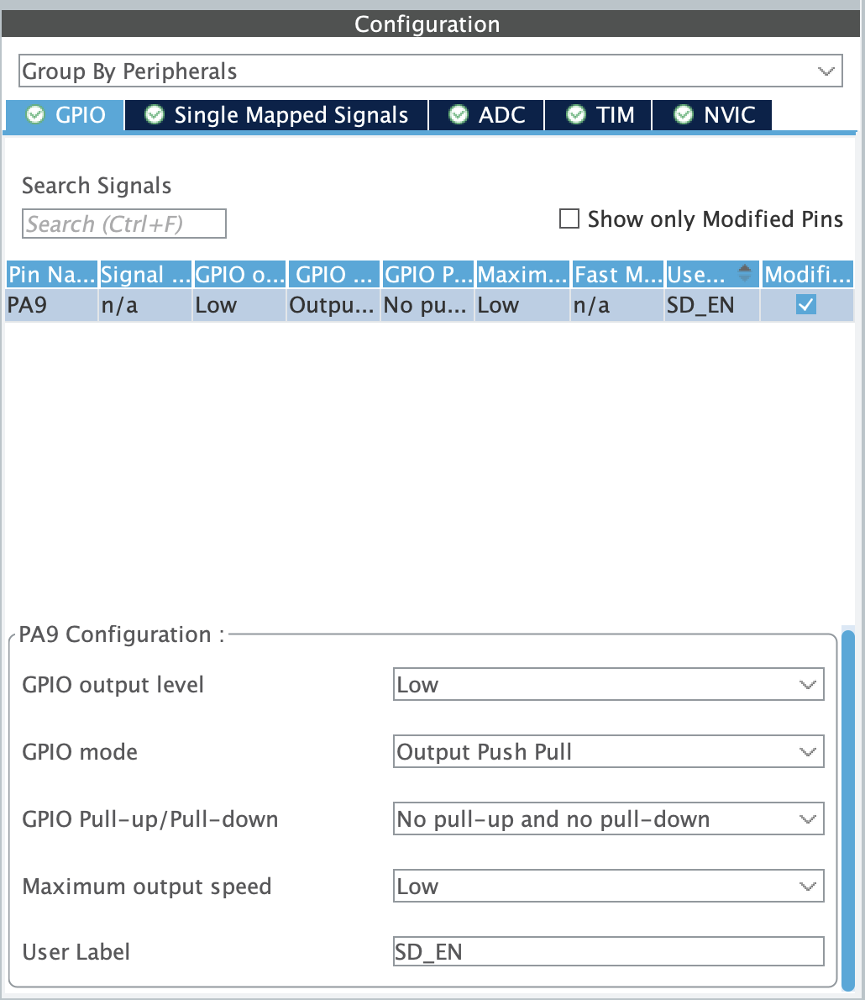

# Firmware

Firmware for the buck converter, running on an STM32G474 (Nucleo-G474RE).
The project is generated with STM32CubeMX, and the application code has been using Claude as guidance, inside the `USER CODE` sections of `main.c`.
The CubeIDE project lives in `buck-firmware/`.

## Status

- [x] LED blink (confirms the toolchain, build and flash all work)
- [x] 50 kHz PWM output on TIM1
- [x] ADC reading of the output voltage
- [x] PI controller
- [x] Gate-driver shutdown pin (`SD_EN`, PA9) controlled by the firmware

## LED blink

The green LED toggles every 100 ms from the main loop.

```c
HAL_GPIO_TogglePin(LED2_GPIO_PORT, LED2_PIN);
HAL_Delay(100);
```

Video: [blink.MOV](images/blink.MOV)



Console output of a successful build.

## 50 kHz PWM output

TIM1 channel 1 outputs the switching signal on PA8 (D7). The timer runs from
the 170 MHz clock with no prescaler, so the numbers set the frequency and duty:

| Setting | Value | Result |
| Counter period | 3399 | 170 MHz / 3400 = 50 kHz |
| Pulse | 1417 | 1417 / 3400 = 41.7 % duty |

The timer is started once from `main.c`; after that the hardware generates
the waveform on its own.

```c
HAL_TIM_PWM_Start(&htim1, TIM_CHANNEL_1);
```



PA8 configured as TIM1_CH1.



### Measured on the oscilloscope

D7 measured 50.14 kHz at 41.72 % duty with a 3.36 V amplitude, against 50 kHz, 41.7 % and 3.3 V calculated.


Channel 1 (yellow) is D7, measured at the IR2104's input pin. Channel 2 is the driver's output, covered in the hardware README.

## Closed-loop voltage control

A PI controller runs once per millisecond. It reads the output through the
ADC (average of 16 samples), compares it with a 5 V target, and sets the PWM
duty cycle so the output stays at the target.

| Setting | Value | What it does |
|---|---|---|
| Control rate | 1 kHz | one measurement and update per millisecond |
| KP | 0.002 | proportional gain, duty per volt of error |
| KI | 10 | integral gain, duty per volt-second |
| Soft start | 100 ms | the target ramps from 0 to 5 V |
| Duty limit | 55 % | the controller can never ask for more |
| Over-voltage trip | 5.8 V | above this the output shuts off until RESET |
| Divider ratio | 0.3377 | 5.1 kΩ / (10 kΩ + 5.1 kΩ) |

The gains are deliberately small, to keep the loop well clear of the 700 Hz
resonance of the output inductor and capacitor. The integral term is clamped
to the duty limit so it cannot wind up. The ADC is configured in CubeMX as
12-bit with a 92.5-cycle sampling time, because the divider has a source
resistance of about 3.4 kΩ.



ADC1 settings in CubeMX.

The firmware prints one line every 5 ms over the USB virtual serial port:
time in ms, target in mV, measured output in mV, duty in tenths of a percent.



Serial output once the output is regulating: measured value within about
10 mV of the 5000 mV target, duty settled at 47.2 %.

### Startup


The output follows the ramping target and reaches 5 V in about 0.1 s with no
visible overshoot. A brief dip of about 20 mV near 0.9 s appears in this
capture; I did not identify the cause.

The PI controller code was written with help from Claude. I built, flashed
and tested it on the hardware, and the gains and limits above are the
values I ran.

## Gate-driver shutdown (synchronous version)

PA9 (Arduino pin D8) is configured as a push-pull output labelled `SD_EN`,
starting low, and connects to the IR2104's shutdown pin. The firmware sets it
high only after the PWM is running at 0 % duty, and sets it low on the over-voltage
trip, which switches both MOSFETs off.

```c
/* after the PWM has started, at the end of USER CODE 2 */
HAL_GPIO_WritePin(SD_EN_GPIO_Port, SD_EN_Pin, GPIO_PIN_SET);

/* in the control loop, on a trip */
HAL_GPIO_WritePin(SD_EN_GPIO_Port, SD_EN_Pin, GPIO_PIN_RESET);
```

The controller gains are unchanged from the diode version.



PA9 configured as `SD_EN`.