# Hardware

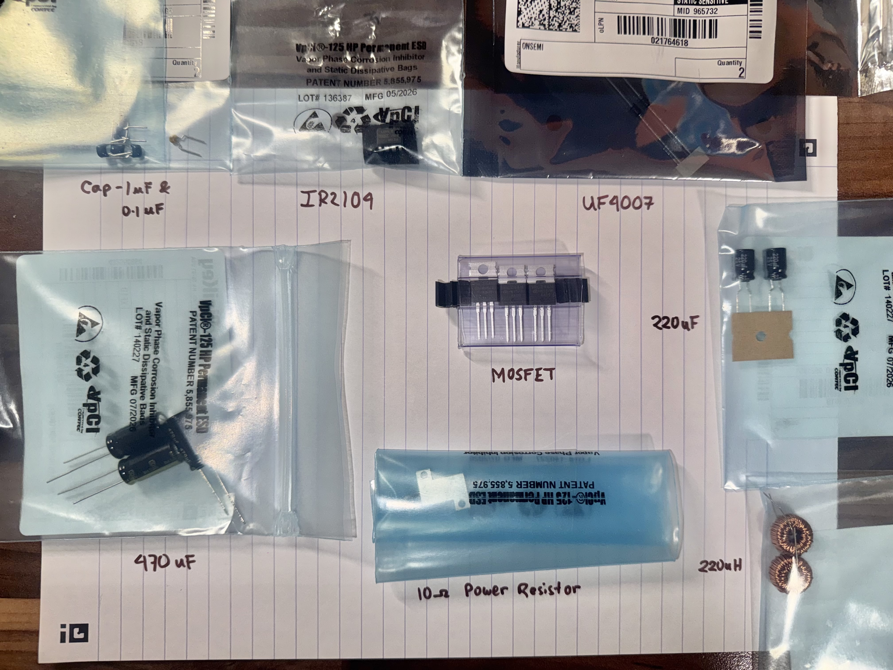

Breadboard build of the buck converter, built and tested in stages.

## Stage 4B: gate driver test (IR2104, no MOSFETs fitted)

The IR2104 was tested on its own first. Its switch pin (VS, pin 6) was tied to
ground, so the high-side output (HO) could be measured with an ordinary
oscilloscope probe. Powered from a Keithley 2231A-30-3 bench supply at 12 V;
the Nucleo-G474RE ran the 50 kHz PWM firmware over USB.

### Wiring

| Connect | To |
|---|---|
| IR2104 pin 1 (VCC) | +12V |
| 0.1 µF ceramic | pin 1 to pin 4 |
| Pin 4 (COM) | GND |
| Pin 2 (IN) | Nucleo D7 (PWM) |
| Pin 3 (SD) | Nucleo 3V3 (active-low shutdown, held high) |
| Pin 5 (LO) | not connected |
| Pin 6 (VS) | GND (temporary, for this test) |
| UF4007 | anode to pin 1, cathode (stripe) to pin 8 |
| 1 µF ceramic | pin 8 to pin 6 |
| Pin 7 (HO) | probe point |
| Nucleo GND | GND |

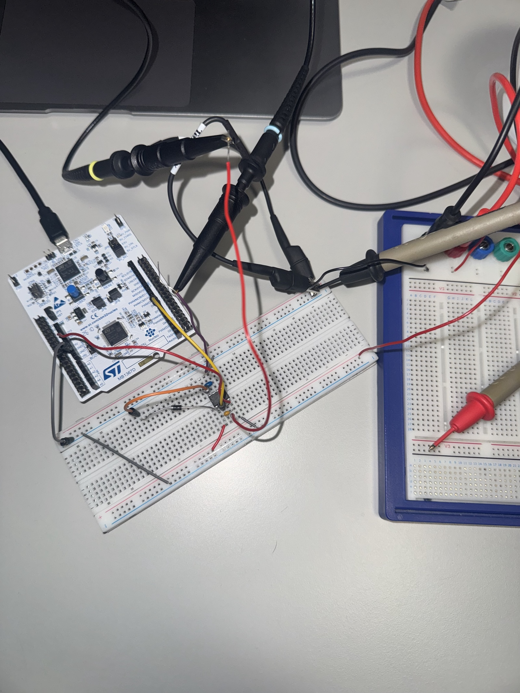

The test setup: IR2104 on the breadboard, Nucleo on the left, oscilloscope
probes on pin 2 (channel 1) and pin 7 (channel 2).

### Results

| Measurement | Result | Expected |
|---|---|---|
| Supply | 12.00 V, 3 mA | 12 V, a few mA |
| VCC (pin 1) | 12.001 V | about 12 V |
| SD (pin 3) | 3.245 V | about 3.3 V (threshold is 3 V) |
| VB (pin 8) | 11.606 V | VCC minus the diode drop |
| HO average (pin 7, multimeter) | 4.517 V | duty cycle x high level |
| IN (pin 2) | 3.36 V, 50.14 kHz, 41.72 % duty | 3.3 V, 50 kHz, 41.7 % |
| HO (pin 7) | 11.60 V, 50.19 kHz, 38.94 % duty | about 11.6 V, 50 kHz, slightly under 41.7 % |

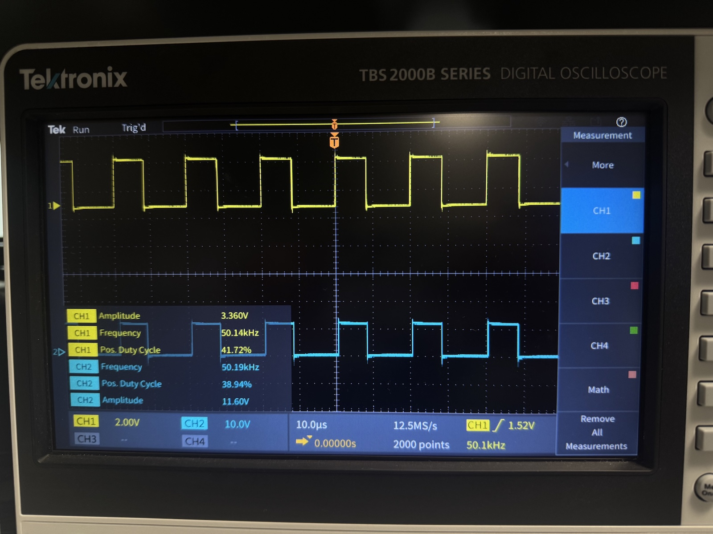

Oscilloscope: channel 1 (yellow) is the PWM input on pin 2, channel 2 (cyan)
is the gate-drive output on pin 7. HO follows IN with the same period.

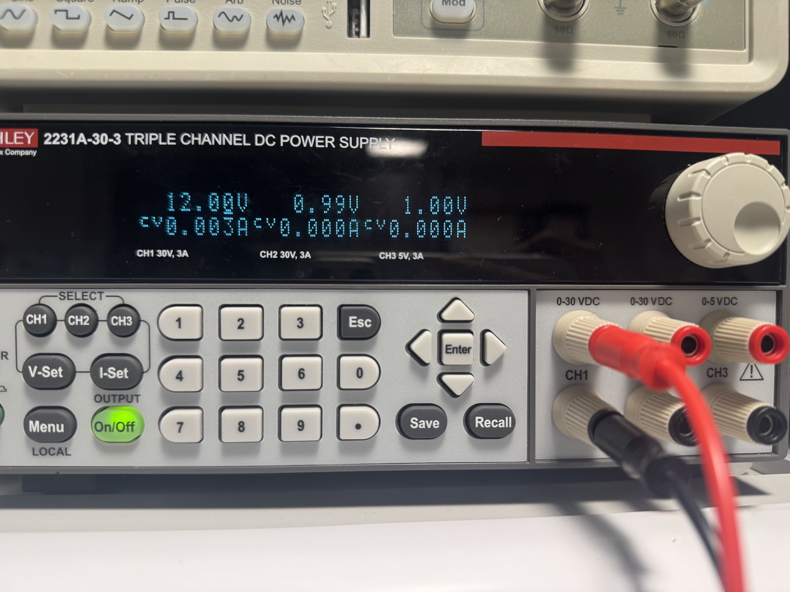

Bench supply: channel 1 in constant-voltage mode at 12.00 V, drawing 3 mA.
Channels 2 and 3 are unused.

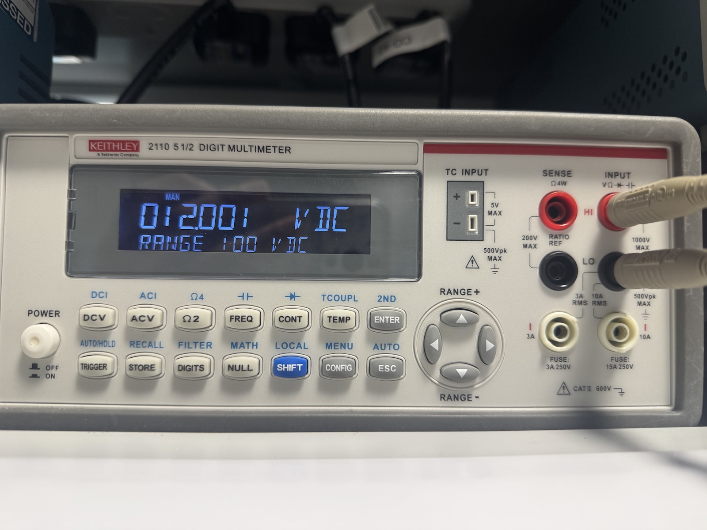

Pin 1 (VCC): 12.001 V.

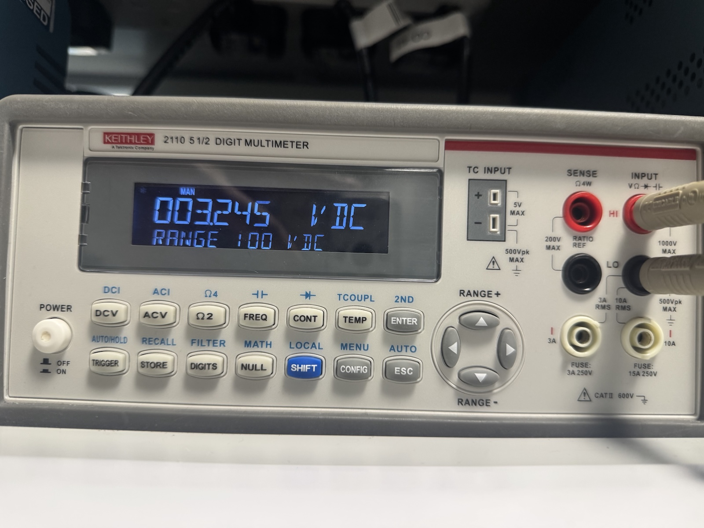

Pin 3 (SD): 3.245 V.

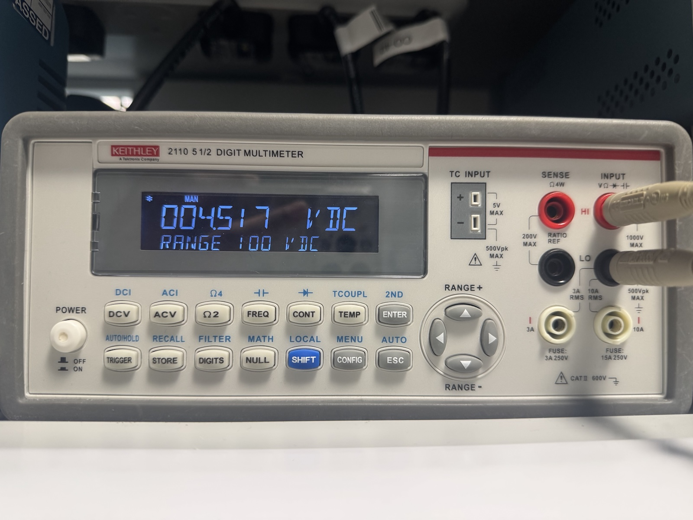

Pin 7 (HO), average: 4.517 V.

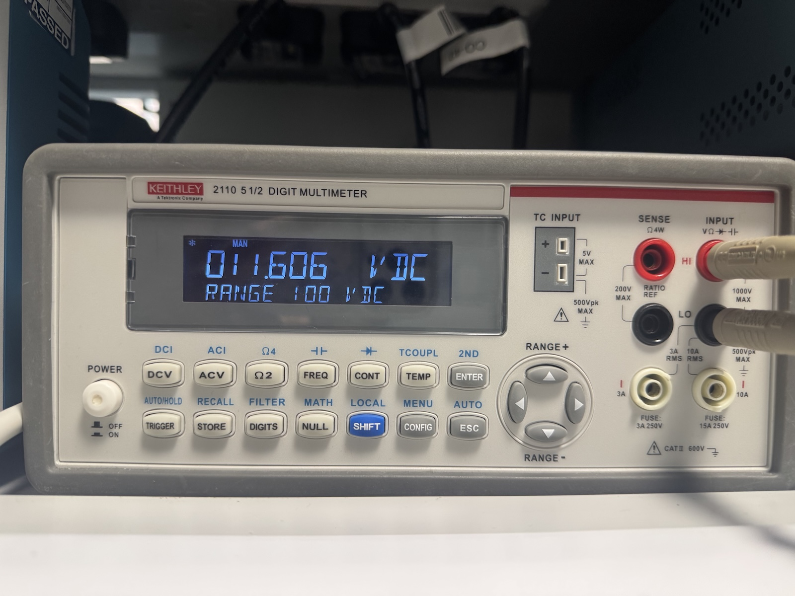

Pin 8 (VB): 11.606 V.

### What the measurements show

- The bootstrap circuit works. HO reaches 11.60 V on the scope, matching the
  11.606 V on VB measured with the multimeter. VB sits about 0.4 V below VCC,
  the forward drop of the UF4007 at this tiny current.
- HO follows IN at the same frequency, but its pulse is about 2.8 points
  narrower (38.94 % against 41.72 %), roughly 0.55 µs of the 20 µs period.
  This is the IR2104's propagation delay: it turns on more slowly than it
  turns off, which trims a little off every pulse. The multimeter agrees:
  11.60 V x 38.94 % = 4.517 V.
- That lost pulse width will pull the output of the open-loop converter slightly
  below the calculated value. The PI controller will compensate for it later.
- The frequency readings (50.14 and 50.19 kHz) are within the scope's
  resolution at 10 µs per division of the 50.000 kHz the timer produces.
- SD sits at 3.245 V, above the 3 V threshold but without much margin.
- The spikes on each edge come from the probe's ground lead and are not
  significant at this stage.

## Stage 4C/4D: power stage (Buck 2, body diode as freewheeling diode)

Pin 6 of the IR2104 was moved from ground to the switching node (SW) and the
power stage was added. Q2's gate is tied to ground, so only its body diode
conducts. First power-up was at 10 V on a current-limited bench supply, then
12 V.

### Wiring added

| Connect | To |
|---|---|
| Q1 drain | +12V |
| Q1 gate | pin 7 (HO) through 10 Ω |
| Q1 source | SW node |
| Q2 drain | SW node |
| Q2 gate and source | GND |
| Pin 6 (VS) | SW node (ground wire from the driver test removed) |
| L1 (220 µH) | SW node to OUT |
| 220 µF capacitor | OUT (+) to GND |
| 470 µF capacitor and 0.1 µF ceramic | across +12V and GND |
| 10 kΩ pull-down | pin 2 to GND |
| 10 Ω power resistor | OUT to GND |

### Results at 12 V

| Measurement | Result |
|---|---|
| Supply voltage | 12.00 V |
| Supply current | 0.183 A |
| Output voltage (multimeter) | 4.3253 V |
| Output voltage (oscilloscope mean) | 4.323 V |
| Load resistance (measured) | 10.11 Ω |
| Output power | 1.850 W |
| Input power | 2.196 W |
| **Efficiency** | **84.3 %** |
| SW high / low level | 12.00 V / -0.600 V |
| SW frequency and duty cycle | 50.09 kHz, 40.11 % (firmware sets 41.7 %) |

Output power is V² / R = 4.3253² / 10.11. Input power is 12.00 V x 0.183 A.
At the first power-up (10 V) the supply drew 0.149 A in constant-voltage mode.

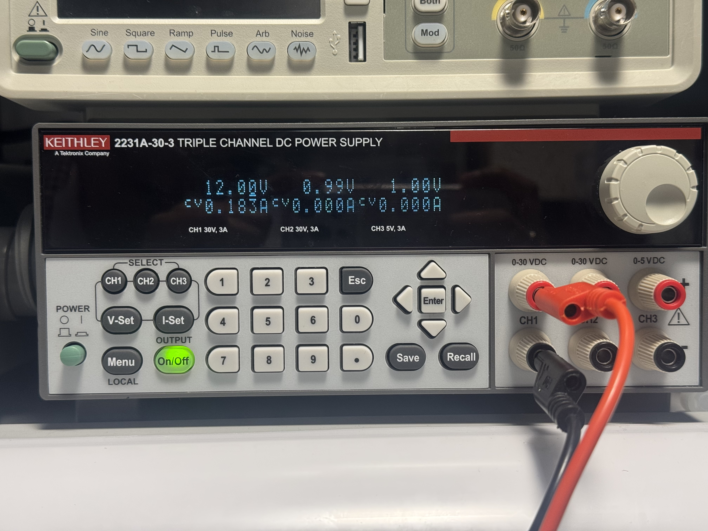

Bench supply, channel 1: 12.00 V at 0.183 A, constant-voltage mode. Channels
2 and 3 are unused.

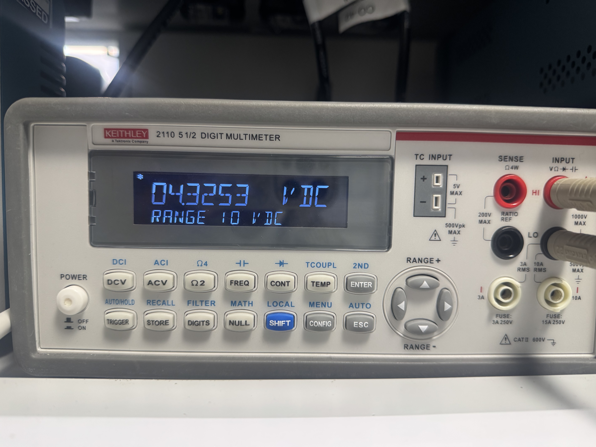

Multimeter on the output: 4.3253 V.

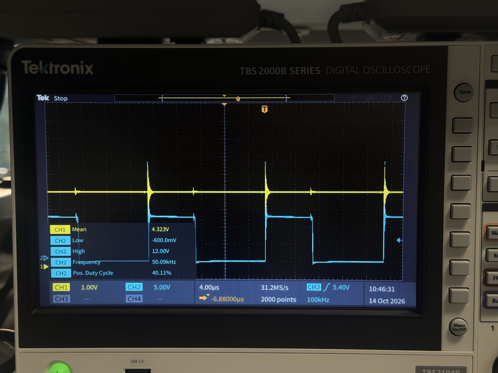

Channel 1 (yellow) is OUT and channel 2 (cyan) is the switching node. The
scope was frozen with Run/Stop on a frame where the automatic readings were
stable. SW swings from 12 V down to -0.6 V, the forward drop of Q2's body
diode.

### Simulation against measurement

| | Simulation | Measured |
|---|---|---|
| Output voltage | 4.45 V | 4.325 V |
| Duty cycle at SW | 41.7 % | 40.1 % |

The measured output is lower because the IR2104 and Q1 turn on more slowly
than they turn off, which shortens every pulse (HO was 38.9 % against 41.7 %
at the input in the driver test), and because of resistance in the inductor
and the breadboard.

### Where the losses go (estimates)

Total loss is 0.35 W. About 0.15 W is Q2's body diode conducting for 60 % of
each cycle at 0.6 V. The rest is the driver and gate charge (about 0.06 W),
the inductor winding (about 0.03 W) and switching and wiring losses. The
diode is nearly half of the total, which is the case for making Q2 switch
actively in the synchronous version (Buck 3).

### Notes

- Output ripple was not measured.
- SW shows ringing at each edge. Much of this comes from the probe's long
  ground lead, so it is partly a measurement artefact. The oscilloscope's
  automatic readings jumped between frames because of it.
- The output is about 0.7 V below the 5 V target. This is an open-loop
  converter with no feedback, which the next stage adds.

  ## Stage 5: voltage feedback

A voltage divider brings the output down to a range the Nucleo's ADC can read.
The ratio is 5.1 / (10 + 5.1) = 0.3377, so 5 V at the output is about 1.69 V
at the ADC pin. The 100 nF capacitor smooths the switching ripple and gives
the ADC's sampling capacitor a reservoir to draw from.

| Connect | To |
|---|---|
| 10 kΩ | OUT to the ADC row |
| 5.1 kΩ | ADC row to GND |
| 100 nF ceramic | ADC row to GND |
| Wire | ADC row to Nucleo A0 (PA0, ADC1 channel 1) |

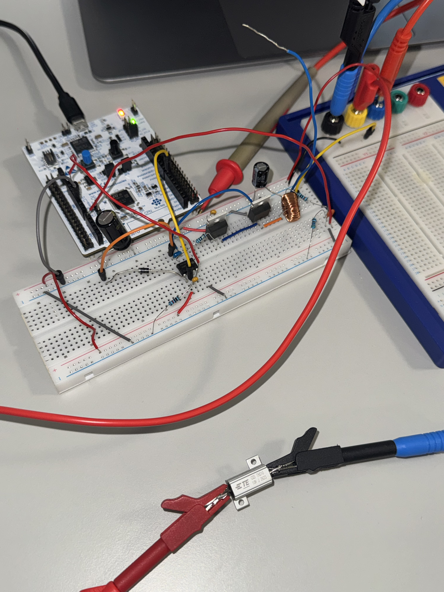

The full setup in the lab, with the 10 Ω power resistor connected through
crocodile clips.

### Results at 12 V, closed loop

| Measurement | Result |
|---|---|
| Supply voltage | 12.00 V |
| Supply current | 0.218 A (first photo) and 0.223 A (line-regulation run) |
| Target output | 5.000 V |
| Output (multimeter) | 4.9878 V (0.24 % below target) |
| Output (Nucleo's own ADC reading) | about 4.99 V |
| Duty cycle chosen by the controller | 47.2 % (open loop at 41.7 % gave 4.325 V) |
| Load resistance (measured) | 10.11 Ω |
| Output power | 2.461 W |
| Input power | 2.62 to 2.68 W |
| **Efficiency** | **about 92 %** (92.0 % at 0.223 A, 94.1 % at 0.218 A) |

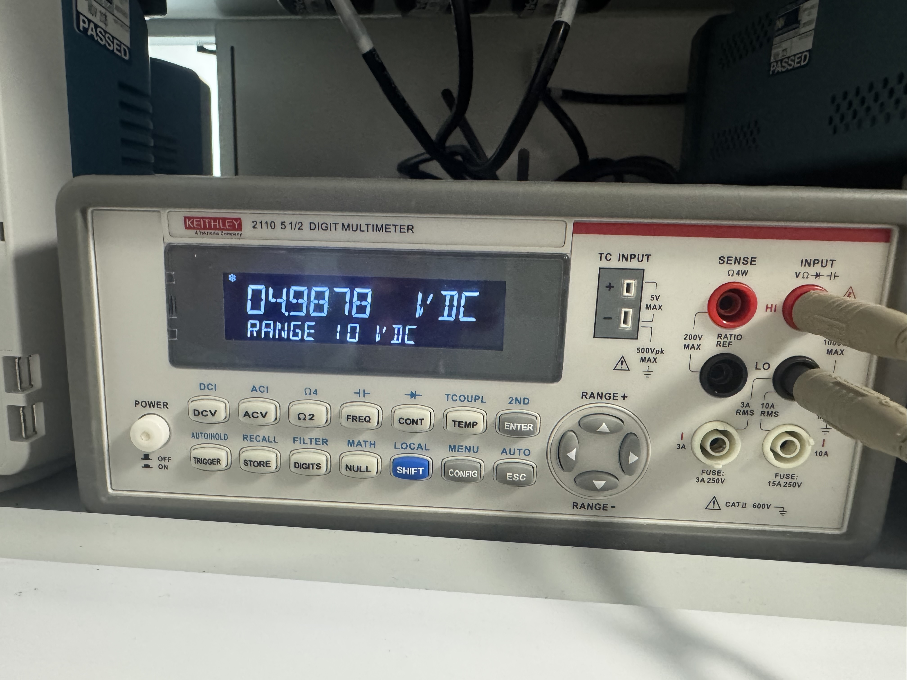

Multimeter on OUT: 4.9878 V.

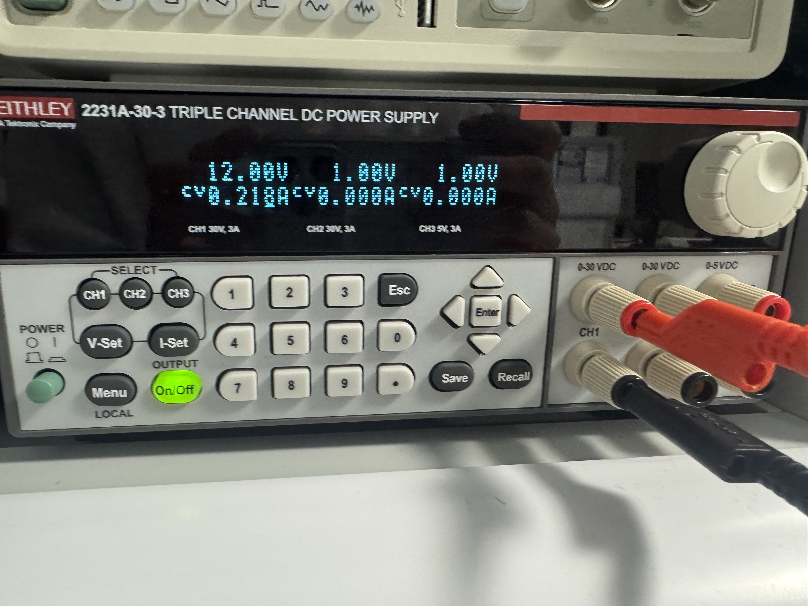

Bench supply: 12.00 V at 0.218 A, constant-voltage mode.

### Line regulation

The input voltage was stepped from 11 V to 14 V with the same 10.11 Ω load.

| Input voltage | 11 V | 12 V | 13 V | 14 V |
|---|---|---|---|---|
| Output (multimeter) | 4.9925 V | 4.9878 V | 4.9851 V | 4.9880 V |
| Supply current | 0.293 A | 0.223 A | 0.205 A | 0.190 A |
| Duty cycle | 51.3 % | 47.3 % | 43.8 % | 40.7 % |
| Output power | 2.465 W | 2.461 W | 2.458 W | 2.461 W |
| Input power | 3.223 W | 2.676 W | 2.665 W | 2.660 W |
| Efficiency | 76.5 % (suspect) | 92.0 % | 92.2 % | 92.5 % |

The output stays within 7.4 mV of 4.99 V across the whole range, about
2.5 mV per volt of input (0.05 % per volt), while the controller cuts the duty
cycle from 51.3 % to 40.7 % to compensate. Duty cycle multiplied by input
voltage stays close to 5.7 V throughout, as the theory predicts.

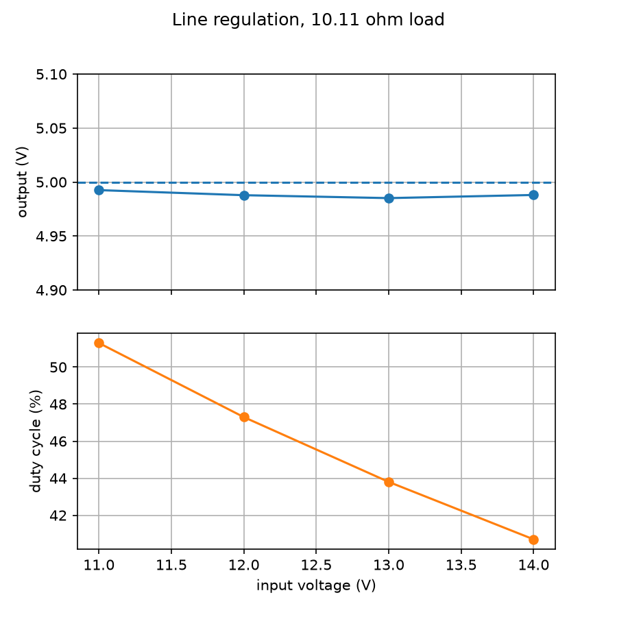

Output voltage and duty cycle against input voltage.

### Notes on the measurements

- The 11 V input current (0.293 A) looks too high. It implies 76 % efficiency
  against about 92 % at the other three voltages, and about 0.04 A more than
  the duty cycle predicts. I did not identify the cause. It may be a reading
  taken before the loop had settled, and it should be re-measured.
- The supply's current display resolves 1 mA and wandered by a few mA between
  readings (0.218 A and 0.223 A at 12 V), which moves the efficiency by about
  2 points. I quote about 92 %, and the uncertainty is several points. The
  synchronous stage will measure input current with the multimeter so that
  both versions are compared in the same way.
- Output ripple was not measured.

## Stage 6: synchronous rectification

In Buck 2 the low-side MOSFET (Q2) had its gate tied to ground, so only its
body diode carried the inductor current while Q1 was off. That diode drops
about 0.6 V at 0.5 A, for more than half of every cycle, which costs roughly
0.14 W. In Buck 3 the IR2104's LO output drives Q2's gate, so Q2 switches on
while Q1 is off. LO is the inverse of the input, with a built-in dead time
between the two outputs so Q1 and Q2 are never on together.

### Wiring changes

| Connect | To |
|---|---|
| Q2 gate | no longer tied to GND. IR2104 pin 5 (LO) through 10 Ω |
| 10 kΩ pull-down | Q2 gate to GND (keeps Q2 off if the LO wire comes loose) |
| IR2104 pin 3 (SD) | Nucleo D8 (PA9, `SD_EN`), previously 3V3 |
| 10 kΩ pull-down | pin 3 to GND (the driver is off while the Nucleo is reset or unpowered) |

### Why the shutdown pin is controlled by the firmware

With LO driving Q2, "no PWM" does not mean "everything off": with the input
low, LO goes high and Q2 turns fully on. If that happens while the output
capacitor is charged (a reset, or the 5.8 V trip), Q2 shorts the inductor to
ground and the capacitor discharges through it. A simple model of the output
stage, not included in this repo, predicts a reverse inductor current of about
3.6 A in that case, even with an ideal inductor. The IR2104's shutdown pin
turns both outputs off, so the firmware raises it only once the PWM is running,
and drops it on a trip. The pull-down keeps it low through a reset.

### Results

| | Buck 2 (earlier the same day) | Buck 3 |
|---|---|---|
| Supply voltage | 12.00 V | 11.99 V |
| Supply current | 0.218 to 0.223 A | 0.212 A |
| Output (multimeter) | 4.9878 V | 4.9740 V |
| Duty cycle chosen by the controller | 47.2 to 47.3 % | 43.9 % |
| Output power (10.11 Ω load) | 2.461 W | 2.447 W |
| Input power | 2.62 to 2.68 W | 2.542 W |
| Efficiency | 92.0 to 94.1 % | **96.3 %** |

A simple model of the converter predicted the duty cycle falling from about
46.7 % to 44.3 %, the supply current falling by about 12 mA, and the
efficiency rising by about 5 points. The measured duty cycle fell by 3.4
points and the efficiency rose by 2 to 4 points depending on which Buck 2
reading is used.

The board with Q2's gate driven from LO.

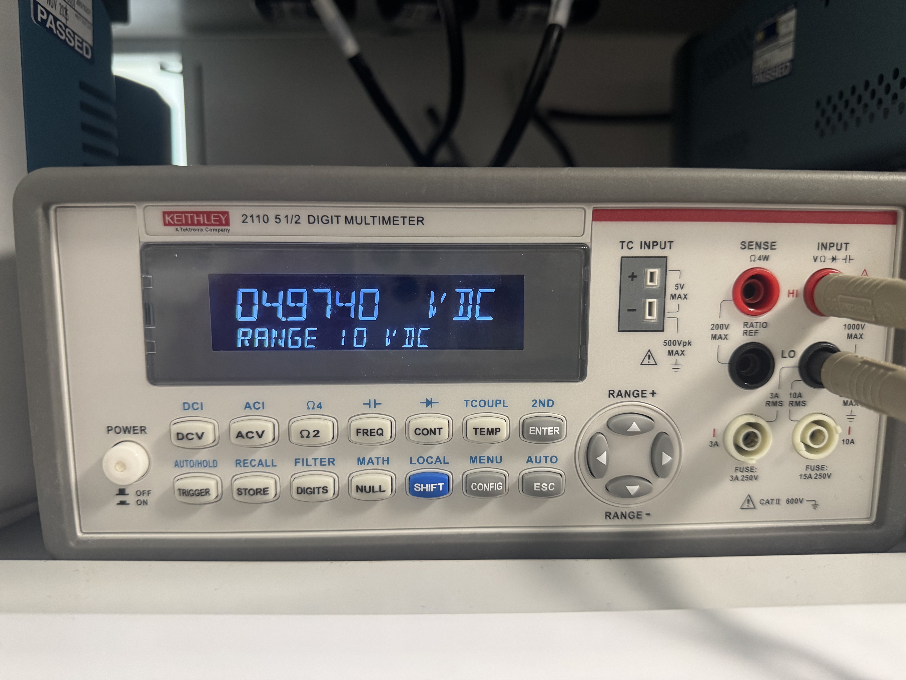

Multimeter on OUT: 4.9740 V.

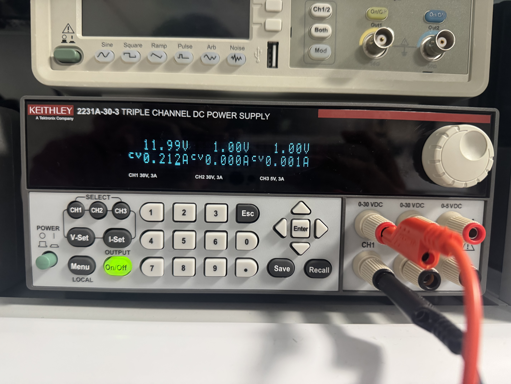

Bench supply: 11.99 V at 0.212 A, constant-voltage mode.

### Notes on the measurements

- The efficiency comes from the supply's current display, which resolves 1 mA
  but wandered by several mA between readings (0.218 A and 0.223 A at 12 V in
  Buck 2). That is worth 2 to 4 points of efficiency, so the figure is
  accurate to a few points. The duty cycle, which comes straight from the
  controller, is the cleaner evidence that Q2 is switching.
- Buck 2 and Buck 3 were not compared back to back in one session. The Buck 2
  numbers are from earlier the same day with the same load.
- The output is 0.5 % below the 5.000 V target on the multimeter, and the
  Nucleo's own reading sits about 17 mV below target with a flat duty cycle.
  An integral controller should remove a steady error like this, and I have
  not found the cause.
- Output ripple, and the voltage on the switching node, were not measured.