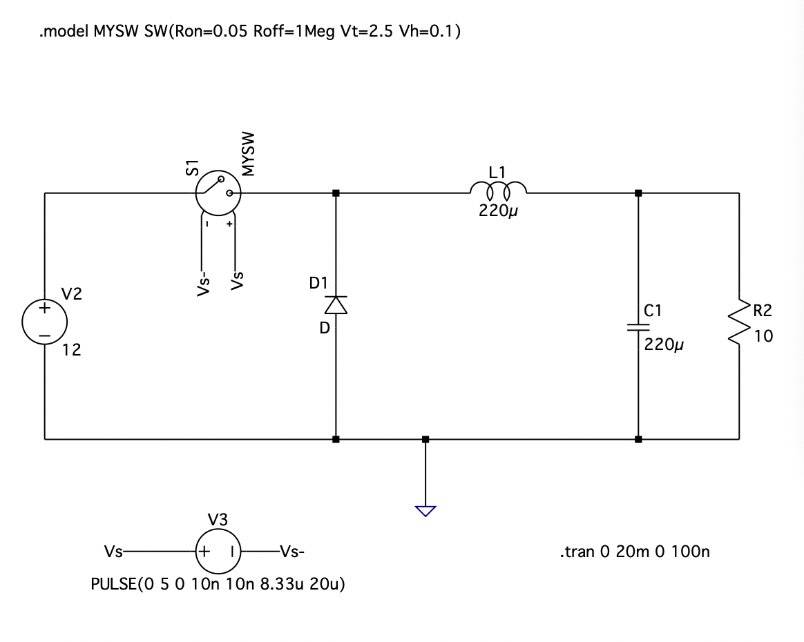
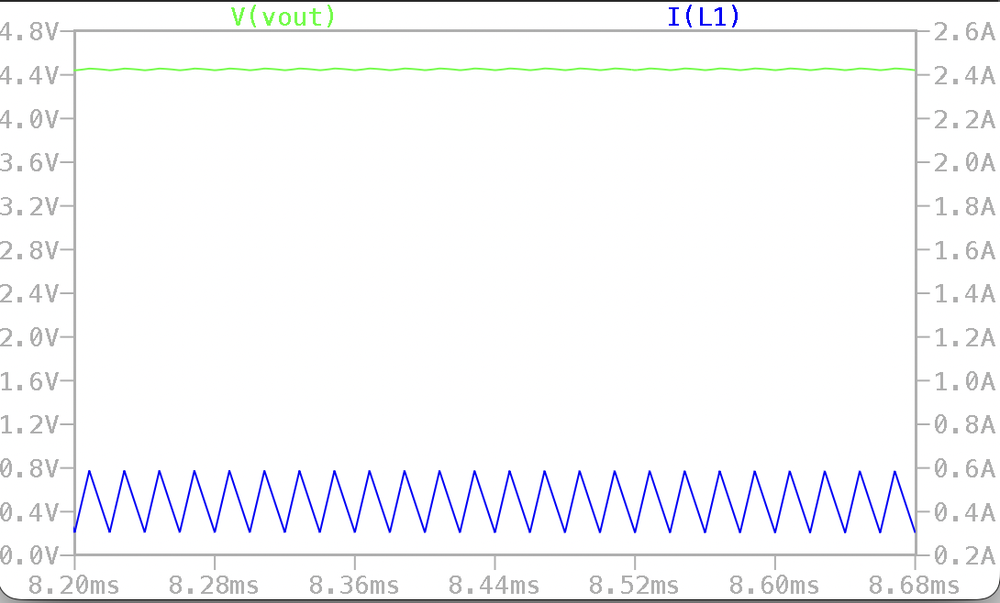
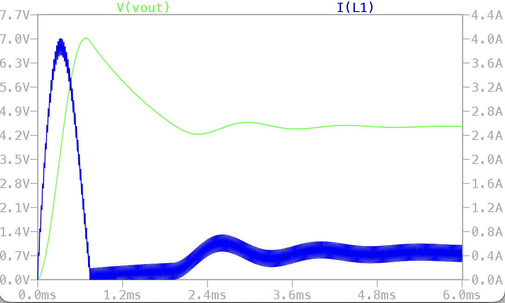

# Simulation

LTspice model of the buck converter: 12V in, 220µH inductor (0.16Ω series resistance), 220µF output
capacitor (56mΩ ESR), 10Ω load, 50kHz switching, 41.7% duty cycle.

Schematic with the component values.

Inductor current and output voltage once the output has settled.

Startup, where the output overshoots before it settles.