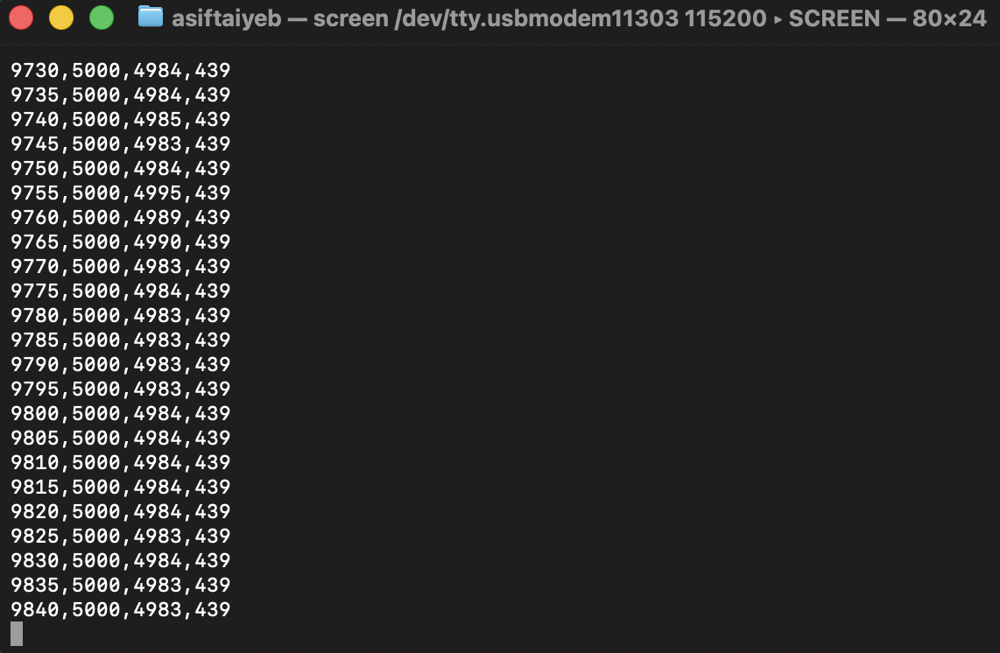
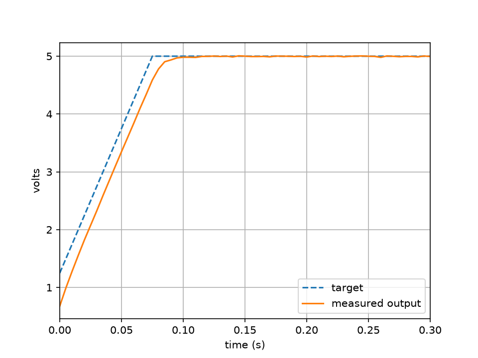

# Test data

| File | What it is |
|---|---|
| [capture.py](capture.py) | records the Nucleo's serial output and plots it (needs pyserial and matplotlib) |
| [analyse.py](analyse.py) | reads the CSV and gives rise time and steady-state numbers, plus a zoomed plot |
| [loop_startup.csv](loop_startup.csv) | serial log of one startup: time (ms), target (mV), output (mV), duty (tenths of a percent) |
| [loop_startup.png](loop_startup.png) | plot of that startup |
| [loop_startup_zoom.png](loop_startup_zoom.png) | the first 0.3 s of the same startup |
| [serial-regulating.png](serial-regulating.png) | screenshot of the serial output while regulating |
| [line_regulation.py](line_regulation.py) | writes the line-regulation readings to a CSV and plots them |
| [line_regulation.csv](line_regulation.csv) | input voltage, output voltage, input current and duty cycle at 11 to 14 V |
| [line_regulation.png](line_regulation.png) | plot of output voltage and duty cycle against input voltage |
| [serial-synchronous.png](serial-synchronous.png) | screenshot of the serial output with the synchronous stage regulating (duty 43.9 %) |

With Q2 switching, the controller holds the output with a duty cycle of 43.9 %, down from about 47 % with the body diode.

Output voltage stays flat while the duty cycle falls as the input rises (body-diode version).

The output follows the ramping target and reaches 5 V in about 0.1 s.

The same startup zoomed in on the first 0.3 s.

Serial output while regulating: measured value within about 10 mV of the 5000 mV target.

